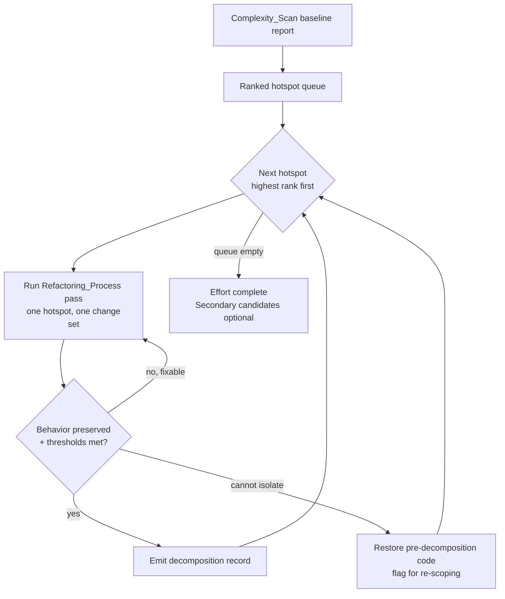
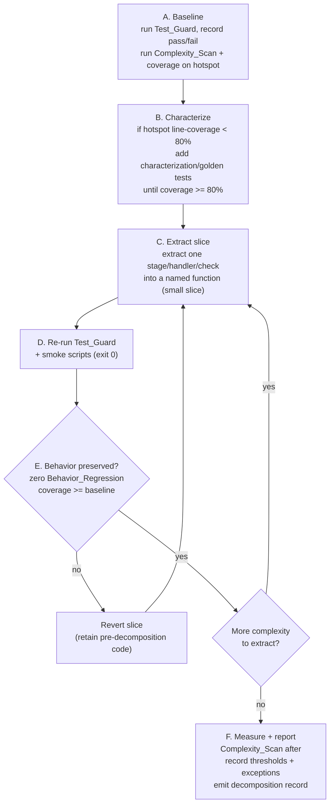
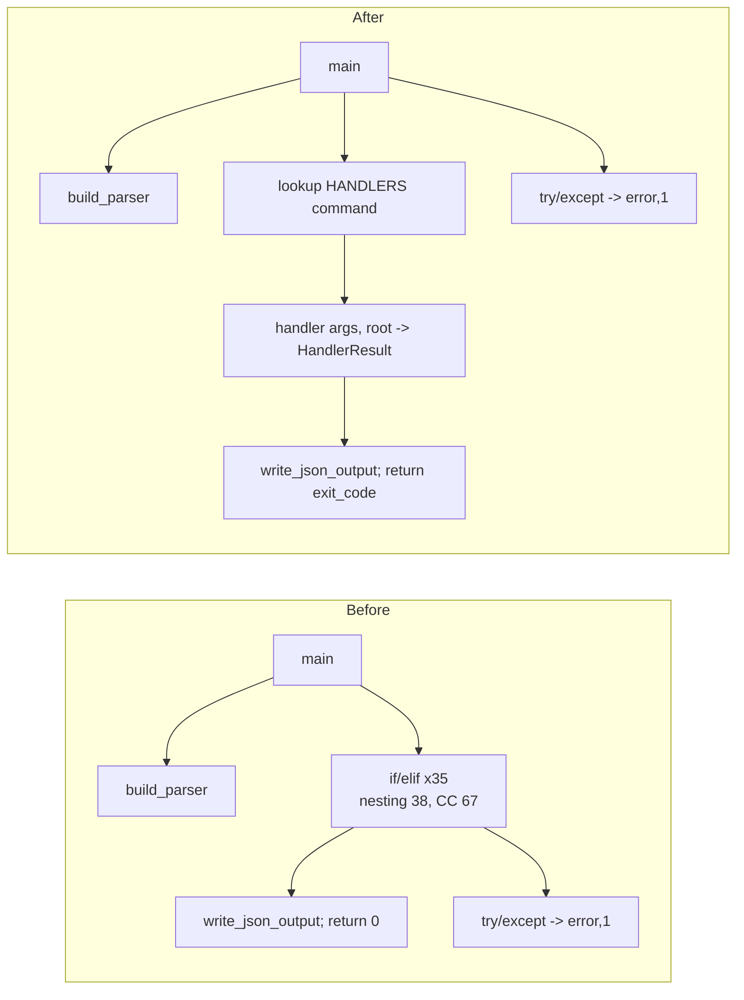
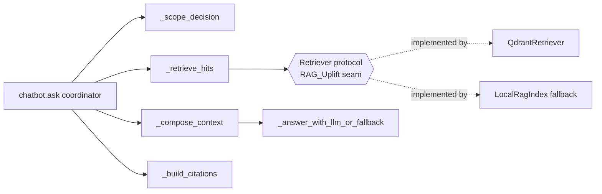
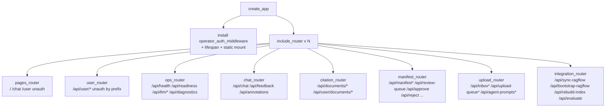

# Design Document

## Overview

This document designs an internal, behavior-preserving refactoring effort: decomposing the eight primary complex-code hotspots in `poc_workflow/` into smaller, bounded, independently testable units, delivered one hotspot at a time as independently reversible change sets. It delivers no new user-facing behavior.

The design is grounded in an AST complexity scan of `poc_workflow/` (38 files, ~30,000 LOC, 1,076 functions). The codebase is broadly healthy: 90.1% of functions already meet the `Complexity_Threshold` (CC ≤ 15, LOC ≤ 80, nesting ≤ 5) and the median CC is 4. Complexity is concentrated in a small tail — the eight ranked hotspots below. This is therefore a **targeted tail-trimming** effort, not a mass refactor (see Non-Goals).

Two ideas anchor the whole design:

1. **A repeatable Refactoring_Process ("decomposition playbook")** that every hotspot passes through identically: baseline `Test_Guard` + coverage capture → raise characterization coverage to ≥ 80% of the hotspot → extract in small slices → re-run `Test_Guard` → measure complexity → emit a per-hotspot decomposition record. (Requirements 1, 2, 3, 4, 13.)
2. **A formalized Complexity_Scan tool** kept in the repo (the ad-hoc scan used to find these hotspots was throwaway) that measures CC/LOC/nesting and produces the before/after report each decomposition record cites. (Requirements 2, 13.)

The overriding constraint is **behavior preservation**: identical CLI exit codes and stdout/stderr, identical HTTP status/body, identical persisted records, and identical QA/answer text + citations for the same inputs and configuration (Requirement 1). Every structural change is guarded by the existing pytest suite, the smoke scripts, and characterization (golden) tests captured *before* any edit.

The effort is sequenced to reduce friction with the in-flight RAG uplift (`specs/001-improve-rag-end-to-end`): the `chatbot.ask` decomposition lands its extracted retrieval unit on the planned `Retriever` protocol seam so the two efforts converge rather than collide (Requirement 7).

### Requirement coverage map

| Design section | Requirements |
|---|---|
| Refactoring_Process (playbook) | 1, 3, 4, 13 |
| Complexity_Scan tool | 2, 13 |
| Decomposition record format | 2.5, 12.4, 12.5, 13 |
| Characterization-testing strategy | 1, 3 |
| Sequencing & reversibility | 4 |
| Hotspot 1 — QA agent workflow | 5 |
| Hotspot 2 — CLI dispatcher | 6 |
| Hotspot 3 — chatbot answer path | 7 |
| Hotspot 4 — data audit gate | 8 |
| Hotspot 5 — chat response assembly | 9 |
| Hotspot 6 — source pipeline | 10 |
| Hotspot 7 — upload orchestrator | 11 |
| Hotspot 8 — webapp factory | 12 |
| Correctness Properties | 1, 2, 3, 4, 12 |
| Error Handling | 1.6, 3.5, 4.8, 6.4 |
| Testing Strategy | 1, 3, 13 |

## Architecture

### The effort as a pipeline of identical, reversible passes

The Decomposition_Effort is a sequence of per-hotspot passes. Each pass is one `Reversible_Change` (one branch / one change set, one hotspot), runs the same playbook, and ends by either producing a decomposition record (success) or restoring the pre-decomposition code (failure / cannot-isolate). No pass starts until the previous pass is delivered or abandoned (Requirement 4.7).



### The Refactoring_Process (decomposition playbook)

Every hotspot is decomposed by the same six-phase procedure. Phases B and E are the gates that enforce behavior preservation.



Phase semantics:

- **A. Baseline** (Req 3.1): run the full `Test_Guard`; record each test's baseline pass/fail and the hotspot's baseline line-coverage %. Capture the hotspot's before-metrics from the `Complexity_Scan`.
- **B. Characterize** (Req 3.2): if baseline hotspot line-coverage < 80%, add `Characterization_Test`s that pin the current `Observable_Behavior` until coverage ≥ 80%. These are captured before any structural edit, so they encode *current* behavior as the golden reference.
- **C. Extract slice** (Reqs 5–12): pull exactly one cohesive responsibility (a stage, a command handler, an audit check, a route group) into a separately named function/module. Slices are kept small so the re-run in D isolates any regression to the latest slice.
- **D. Re-run Test_Guard** (Reqs 3.3, 3.6): full pytest plus the two smoke scripts `poc_workflow/user_chat_render_smoke.py` and `poc_workflow/qa_test_eval.py`, each required to exit 0.
- **E. Behavior gate** (Reqs 1.6, 3.4, 3.5): a slice is accepted only if there is zero `Behavior_Regression` and coverage ≥ baseline; otherwise the slice is reverted and re-attempted. The pre-decomposition code is retained until the gate passes.
- **F. Measure + report** (Reqs 2.4, 13): re-run the `Complexity_Scan`, confirm each resulting function meets the `Complexity_Threshold`, record any justified exception, and emit the single per-hotspot decomposition record before the hotspot is marked complete (Req 13.6).

### Where the new artifacts live

```text
poc_workflow/            # unchanged single package; hotspots refactored in place,
                         # with new sibling modules added where noted per hotspot
scripts/
  complexity_scan.py     # NEW: kept Complexity_Scan tool (AST: CC, LOC, nesting)
tests/
  characterization/      # NEW: golden tests captured per hotspot before edits
    test_cli_golden.py
    test_webapp_routes_golden.py
    test_qa_agent_golden.py
    ... (one module per hotspot)
  fixtures/golden/        # NEW: stored golden payloads / route inventory snapshots
.kiro/specs/complex-code-decomposition/
  decomposition-records/  # NEW: one record per hotspot (see record format)
    01-qa-agent-workflow.md
    02-cli-main.md
    ...
    route-inventory.json   # Req 12.5 machine-readable route inventory
```

The `Complexity_Scan` lives in `scripts/` (alongside the existing `scripts/local_openai_embedding_server.py`) because it is an operational dev tool, not part of the shipped package. Decomposition records live under the spec folder so review artifacts travel with the spec; the Req 12.5 route inventory is additionally emitted as machine-readable JSON for assertion in tests.

## Components and Interfaces

### Component 1: Complexity_Scan tool (`scripts/complexity_scan.py`)

A standalone, dependency-light AST analyzer (Python `ast` only) that the team runs to verify thresholds and generate the before/after report referenced by every decomposition record (Reqs 2.1–2.4, 13.1).

Responsibilities:
- Walk a target path, parse each `.py` file with `ast`, and compute per-function `Cyclomatic_Complexity`, `Function_Length` (LOC of the function body), and `Nesting_Depth`.
- Emit a per-function pass/fail against the `Complexity_Threshold`.
- Support a baseline/after diff so a record can show before vs after for a single hotspot.

Interface (CLI + importable):

```text
python -m scripts.complexity_scan <path> [--json OUT] [--baseline FILE] [--only DOTTED_NAME ...] [--fail-over-threshold]

# importable
scan_path(path: Path, *, only: set[str] | None = None) -> list[FunctionMetric]
diff_reports(before: list[FunctionMetric], after: list[FunctionMetric]) -> ScanDiff
```

Metric computation rules (made explicit so results are reproducible and match the scan that produced the hotspot inventory):
- **CC**: 1 + count of decision points (`if`, `elif`, `for`, `while`, `and`, `or`, `except`, comprehension `if`, ternary, `case`).
- **LOC**: `end_lineno − lineno + 1` of the function node (body length including signature).
- **Nesting_Depth**: maximum depth of nested control-flow blocks (`if/for/while/with/try`) within the function.

Output shape (`--json`):

```json
{
  "generated_at": "<iso8601>",
  "target": "poc_workflow",
  "threshold": {"cc": 15, "loc": 80, "nesting": 5},
  "functions": [
    {"qualname": "qa_agent_workflow._run_qa_agent_workflow_impl",
     "file": "poc_workflow/qa_agent_workflow.py", "lineno": 424,
     "cc": 99, "loc": 623, "nesting": 9,
     "pass": false, "exceeds": ["cc", "loc", "nesting"]}
  ],
  "summary": {"function_count": 1076, "passing": 970, "failing": 106, "pass_rate": 0.901}
}
```

The exit code is 0 unless `--fail-over-threshold` is set and any in-scope function exceeds a limit, so the tool can be used both for reporting and as an optional CI guard.

### Component 2: Characterization test harness (`tests/characterization/`)

Reusable helpers that capture and compare `Observable_Behavior` per hotspot type. These encode the golden reference in Phase B and are the executable form of Requirement 1.

| Hotspot type | Capture | Compare | Normalization |
|---|---|---|---|
| CLI (`cli.main`) | exit code + stdout + stderr via `subprocess`/`capsys` | byte-for-byte equality | none (Req 6.2 is byte-exact) |
| HTTP (`webapp`) | status + body + content-type via FastAPI `TestClient` | equality minus volatile fields | drop timestamps / auto-ids (Req 1.3) |
| Answer path (`chatbot.ask`, QA workflow) | answer text + citation set | text equality; citations set-equal | order-insensitive citations (Req 1.4) **except** `chatbot.ask` order-sensitive (Req 7.2) |
| Persisted records (`pipeline`, `upload_processing`, `quality_gate`) | DB rows / manifest / filesystem artifacts | equality minus volatile fields | drop timestamps / auto-ids (Req 1.5) |

Interface sketch:

```python
def golden_cli(args: list[str], *, root: Path) -> CliCapture          # exit, stdout, stderr
def golden_http(client: TestClient, method, path, **kw) -> HttpCapture # status, body, ctype
def golden_answer(fn, *, order_sensitive: bool) -> AnswerCapture       # answer, citation set
def assert_equivalent(before, after, *, ignore: set[str] = VOLATILE)   # zero-regression check
```

`VOLATILE` centralizes the inherently non-deterministic fields excluded by Reqs 1.3/1.5 (timestamps, auto-generated ids, `latency_ms`, `generated_at`, run ids).

### Component 3: Hotspot decomposition targets

Each hotspot below names the extracted functions and where they live. All extractions keep the existing public entry point (name, parameters, return contract) unchanged so callers need no change.

#### Hotspot 1 — `qa_agent_workflow._run_qa_agent_workflow_impl` → bounded stages (Req 5)

The impl is a 623-LOC, CC-99 function: a preamble of guards/config plus a retrieve→draft→verify→critic→comply loop, with many early-return result dicts. Extraction strategy: pull each stage into a named pure-ish function that takes an explicit context object and returns a small result; keep the loop and the result-dict assembly in a slim orchestrator. The closures `add_step`, `answer_run`, and `failed` become helpers bound to a `QaRunContext` so trace/step semantics are preserved exactly.

Extracted functions (private, same module `qa_agent_workflow.py`):

| Stage (from Req 5.1) | Extracted function |
|---|---|
| scope gating | `_stage_scope_gate(ctx) -> StageOutcome` |
| query analysis | `_stage_analyze_query(ctx) -> StageOutcome` |
| retrieval planning | `_stage_plan_retrieval(ctx) -> RetrievalPlan` |
| evidence retrieval | `_stage_retrieve_evidence(ctx, queries) -> list[EvidenceChunk]` |
| evidence-pack construction | `_stage_build_evidence_pack(ctx, chunks) -> EvidencePack` |
| format planning | `_stage_plan_format(ctx, pack) -> FormatPlan` |
| answer drafting | `_stage_draft_answer(ctx, pack, plan) -> StructuredAnswer` |
| answer verification | `_stage_verify_answer(ctx, draft, pack, plan) -> Verification` |
| critique | `_stage_critic(ctx, draft, pack) -> QualityDecision` |
| procedure-compliance checking | `_stage_procedure_compliance(ctx, draft, pack) -> Compliance` |
| final formatting | `_stage_finalize(ctx, draft, chunks) -> dict` |

Supporting helpers: `_build_result(ctx, **fields)` (single builder for every return dict so the key set stays identical), `_failed_result(ctx, reason, detail)` (replaces the `failed` closure), `_clarification_result(...)`, `_no_answer_result(...)`. The retrieve→verify→critic→comply loop stays in the orchestrator (`_run_qa_agent_workflow_impl`) but each iteration body delegates to the stage functions, bringing the orchestrator under the threshold. The public `run_qa_agent_workflow` entry point is untouched (Req 5.4). Returned result fields and the persisted answer-run record are preserved via the single `_build_result` builder (Reqs 5.2, 5.3).

#### Hotspot 2 — `cli.main` → command-handler registry (Req 6)

`cli.main` is a ~35-branch `if/elif` over `args.command`, each branch mapping args → a domain function → `write_json_output(result); return 0`, wrapped in one top-level `try/except` that emits `{"ok": false, "error": ...}` and returns 1. Two branches return early before the shared `write_json_output` (sync-ragflow `--dry-run`, quality-gate). Decompose into a **dispatch table** of handlers.

Before/after:



Design:
- A handler signature `Handler = Callable[[argparse.Namespace, Path], HandlerResult]`, where `HandlerResult` is either a payload (default: write + exit 0) or an explicit `(payload, exit_code)` to preserve the two early-return branches (sync-ragflow dry-run, quality-gate return 0/1 on status).
- A `HANDLERS: dict[str, Handler]` registry maps each command name to a small handler function (`_cmd_init`, `_cmd_process_source`, `_cmd_sync_ragflow`, `_cmd_quality_gate`, …). Each handler is well under the threshold.
- `cli.main` becomes a thin router: parse args, resolve root, look up the handler, run it inside the existing `try/except`, call `write_json_output`, and return the exit code. The `else: parser.error(...)` unknown-command path and the `except Exception` → `{"ok": false, "error": str(exc)}` + return 1 path are preserved exactly (Reqs 6.2, 6.4).
- `build_parser()` is untouched, preserving the full argparse contract — subcommand names, positionals, flags, choices, types, and env-backed defaults (Req 6.3).

Handlers live in `cli.py` (private `_cmd_*` functions) to keep the change a single isolated module edit; the registry is built once at module load.

#### Hotspot 3 — `chatbot.ask` → retrieval / scope-gating / context-composition / citation units (Req 7)

`ask` (558 LOC, CC 59, depth 9) interleaves provider selection (ragflow chat, ragflow retrieval, local), scope gating, catalog/standard retrieval, LLM answering with markup-retry fallback, query logging, and gap creation — with a large family of early-return result dicts. Extraction separates the four responsibilities named in Req 7.1 and routes retrieval through the RAG_Uplift `Retriever` protocol seam (Reqs 7.4, 7.5).

Extracted units:

| Responsibility | Extracted unit | Location |
|---|---|---|
| retrieval | `_retrieve_hits(retriever, query, *, department, category) -> RetrievalResult` | new `chatbot_retrieval.py` (sits on `Retriever` protocol) |
| scope gating | `_scope_decision(query) -> ScopeDecision` | `chatbot.py` (wraps `is_out_of_scope_query`) |
| context composition | `_compose_context(hits, query, answer_style) -> AnswerContext` | `chatbot.py` |
| citation building | `_build_citations(hits) -> list[dict]` | `chatbot.py` (wraps `citation_payload`) |
| LLM answer + fallback | `_answer_with_llm_or_fallback(ctx, hits) -> AnswerOutcome` | `chatbot.py` |
| result assembly | `_ask_result(**fields) -> dict` | `chatbot.py` (single builder; identical key set) |

The provider branches (ragflow-chat / ragflow-retrieval / local) become `_ask_via_ragflow_chat`, `_ask_via_ragflow_retrieval`, and `_ask_via_local_index`, each returning through `_ask_result`. `ask` becomes a coordinator that picks the provider path, then runs scope-gate → retrieve → compose → answer → cite → log. Because Req 7.2 requires **order-sensitive, character-for-character** equality, the citation builder preserves hit order exactly (this is the one answer path the characterization harness compares order-sensitively).

RAG seam (Reqs 7.4, 7.5):



`_retrieve_hits` depends only on the `Retriever` protocol (`search(query, *, department, category, limit) -> list[Hit]`), so any conforming retriever — including the `LocalRagIndex` fallback — substitutes without touching scope-gating, context-composition, or citation-building (Req 7.4). When the RAG uplift adopts its retrieval/context abstraction, the change is confined to `_retrieve_hits` and `_compose_context` (Req 7.5). The protocol is referenced, not redefined here; if the RAG package has not yet landed it, the decomposition defines a minimal local `Retriever` Protocol that `LocalRagIndex` already structurally satisfies, so the seam is forward-compatible.

#### Hotspot 4 — `quality_gate.data_audit_gate` → named check predicates (Req 8)

`data_audit_gate` (CC 59, 140 LOC) accumulates `blockers` and `warnings` across several inline audit passes, then returns a `check_result(...)`. It early-returns a fail `check_result` if the manifest is corrupt/unreadable. Extraction turns each audit pass into a named check that appends to a shared `AuditAccumulator` (ordered blockers, ordered warnings, metrics), preserving append order exactly (Req 8.3).

Extracted check functions (same module `quality_gate.py`):

| Check | Function |
|---|---|
| manifest load + duplicate-key + array shape (early-return on corrupt) | `_audit_load_manifest(root, acc) -> list[ManifestRecord] | None` |
| record metadata + normalized-markdown + QA-report checks | `_audit_records(root, records, acc)` |
| active-family older-revision warnings | `_audit_active_families(records, acc)` |
| `technical_active` index staleness | `_audit_active_index(root, served_latest_versions, acc)` |
| taxonomy issues (prod blocks vs local warns) | `_audit_taxonomy(root, production, acc)` |
| status/severity + metrics finalization | `_finalize_audit(acc, production) -> dict` |

`_audit_load_manifest` returning `None` signals the corrupt/unreadable early-return, and the orchestrator returns the same fail `check_result` as today (Req 8.4). The orchestrator `data_audit_gate` keeps its name and `(root, *, production)` signature (Req 8.5) and simply sequences the checks against one accumulator, then returns `_finalize_audit(...)`. Status/warn/fail, severity, and the ordered blocker/warning lists are produced by appending in the same sequence the inline code uses today (Reqs 8.2, 8.3).

#### Hotspot 5 — `user_chat.user_chat_response` → response-path assembly (Req 9)

`user_chat_response` (CC 37, 259 LOC) has five response paths: annotated-answer match, out-of-scope rejection, clarification request, QA-agent answer, and standard retrieval answer. The latter four already delegate to helpers (`scope_reject_response`, `clarification_response`, `qa_agent_chat_response`, plus the `ask`-based standard path); the bulk of the complexity is the inline annotated-answer branch and the inline standard-answer assembly.

Extracted functions (same module `user_chat.py`):

| Path | Extracted function |
|---|---|
| annotated-answer match | `_annotated_answer_response(db, root, query, ...) -> dict` |
| standard retrieval answer assembly | `_standard_answer_response(root, db, policy, query, ...) -> dict` |
| session/trace envelope shared by paths | `_session_envelope(session, active_session_id) -> dict` |
| context-step + trace decoration | `_decorate_trace(result, history, ...) -> dict` |

`user_chat_response` becomes a dispatcher: build session, evaluate annotation → scope → clarification → qa-agent → standard, returning the first matching path's payload. Each path returns the same response payload key set and values as today (Reqs 9.2, 9.3), reusing a single envelope builder so the key set cannot drift. The entry point name and parameters are unchanged (Req 9.4).

#### Hotspot 6 — `pipeline.process_sources` → pipeline stages (Req 10)

`process_sources` (CC 30, 416 LOC) is a per-source loop wrapped in a `try/except`, running: prepare/classify → skip-unchanged check → convert (MinerU) → QA audit → validate → build RAG-ready package → evolution → stage + manifest upsert + status, with failure handling that logs ingestion, records a failed/ocr status, moves inbox lifecycle, and moves the file to `failed`.

Extracted functions (same module `pipeline.py`), each operating on a small `SourceJob` context:

| Stage | Function |
|---|---|
| metadata read + validate + classify status | `_prepare_source(root, source_file, converter) -> SourceJob` |
| skip-unchanged short-circuit | `_skip_if_unchanged(root, job, store, db) -> bool` |
| MinerU conversion + handoffs | `_convert_source(root, job, converter)` |
| QA audit + audit handoff | `_audit_source(root, job)` |
| build RAG-ready package + index handoff | `_build_rag_ready(root, job)` |
| evolution report + review status | `_record_evolution(root, job)` |
| stage + manifest upsert + done status + lifecycle | `_finalize_source(root, job, store, db) -> ManifestRecord` |
| failure handling | `_handle_source_failure(root, job, exc, db)` |

`process_sources` keeps its signature and becomes the loop that calls the stages and appends successful records. The skip path, failure classification (ocr_required vs failed_review), ingestion-log entries, processing-status records, inbox lifecycle moves, and the converted/normalized + RAG-ready artifacts are all preserved because the stage bodies are moved verbatim, only relocated (Reqs 10.2, 10.3, 10.4).

#### Hotspot 7 — `upload_processing.process_upload_document_group` → orchestration steps (Req 11)

This orchestrator (CC 26, 384 LOC) validates the group, then runs: classify event → stage sources → probe + convert candidates → select primary → convert handoff → initial audit/repair → normalize markdown → QA recheck → (terminal-fail or) index handoff → human-review packet → manifest upsert → terminal reports. It has several terminal outcomes (missing business code, no usable converted source, failed QA recheck) via `terminal_*`/`finalize_upload_queue_state` helpers.

Extracted functions (same module `upload_processing.py`), operating on an `UploadRun` context (group, paths, run_id, source_id):

| Step | Function |
|---|---|
| validate department/category + missing-code terminal | `_validate_group(root, group, paths, run_id) -> UploadRun | TerminalResult` |
| stage sources + plan handoff | `_stage_and_plan(root, run)` |
| probe + convert candidates + select primary | `_probe_and_select(root, run, converter, primary_source) -> Selection | TerminalResult` |
| convert handoff + extract-artifacts event | `_record_conversion(root, run, selection)` |
| initial audit + repair handoff | `_initial_audit_and_repair(root, run, selection)` |
| normalize markdown + repair log | `_normalize_and_log(root, run, selection)` |
| QA recheck + final audit (terminal-fail path) | `_qa_recheck(root, run, selection) -> QaRecheck | TerminalResult` |
| index handoff + rag-ready event | `_record_index(root, run)` |
| review packet + manifest upsert + terminal reports + evolve | `_finalize_upload(root, run, selection, final_quality) -> dict` |

The orchestrator keeps its signature and threads the `UploadRun` through the steps, returning early when a step yields a `TerminalResult`. Returned result, terminal workflow status, workflow events, handoffs, reports, normalized output, and the manifest record are preserved; every rejection/failure terminal outcome (unsupported department/category, missing business code, no usable converted source, failed QA recheck) routes through the same `terminal_*`/`finalize_upload_queue_state` helpers as today (Reqs 11.2, 11.3). Entry point unchanged (Req 11.4).

#### Hotspot 8 — `webapp.create_app` → grouped APIRouter modules (Req 12)

`create_app` (~865 LOC) defines ~60 routes inline plus one `operator_auth_middleware`. **Key grounding fact:** auth/access control is *not* per-route; it is enforced by a single path-prefix middleware — every `/api/*` route requires operator auth **except** `/api/auth-status` and any `/api/user/*` route. So moving a route into a router preserves its protection automatically as long as its path and the middleware are unchanged. The static page routes (`/`, `/chat`, `/user`) and `/static` mount are unauthenticated by design.

Extraction: move every inline route into a domain-grouped `APIRouter`; `create_app` becomes a composer that creates the app, installs the middleware and lifespan, mounts static, and calls `include_router(...)` for each group. Routers live in a new `poc_workflow/webapp_routers/` package and receive the `workspace` via the request (`request.app.state.workspace`) so they remain factory-free.



Proposed router grouping (each route registered in exactly one router — Req 12.1):

| Router | Representative routes | Auth (by path prefix) |
|---|---|---|
| `pages_router` | `/`, `/chat`, `/user` | unauthenticated (static pages) |
| `user_router` | `/api/user/bootstrap`, `/api/user/chat`, `/api/user/chat/stream`, `/api/user/session/heartbeat`, `/api/user/feedback`, `/api/user/sessions*`, `/api/user/documents/*` | unauthenticated (`/api/user/*` prefix) |
| `ops_router` | `/api/auth-status`, `/api/health`, `/api/readiness`, `/api/llm/*`, `/api/diagnostics*` | `/api/auth-status` unauth; rest operator-auth |
| `chat_router` | `/api/chat`, `/api/feedback`, `/api/gaps*`, `/api/queries*`, `/api/annotations*` | operator-auth |
| `citation_router` | `/api/documents/{doc_id}/{version}*` (operator citation/preview) | operator-auth |
| `manifest_router` | `/api/manifest*`, `/api/taxonomy`, `/api/review-queue`, `/api/approve`, `/api/human-review`, `/api/reject`, `/api/retire`, `/api/incidents*`, `/api/ingestion-runs*` | operator-auth |
| `upload_router` | `/api/inbox*`, `/api/upload-queue*`, `/api/agent-prompts*` | operator-auth |
| `integration_router` | `/api/sync-ragflow`, `/api/bootstrap-ragflow`, `/api/rebuild-index`, `/api/evaluate` | operator-auth |

Constraints honored:
- After decomposition, `create_app` contains **zero inline route definitions** (Req 12.1).
- The set of `(path, HTTP method)` pairs is identical — no route added or removed (Req 12.3). A characterization test snapshots `app.routes` (path, methods) before and asserts equality after.
- Auth/access-control state per route is preserved because the path-prefix middleware is unchanged and paths are unchanged (Req 12.3). The middleware stays installed in `create_app`.
- The decomposition produces a **route inventory record** enumerating every route with path, HTTP method, target router, and auth state, and **flags any unauthenticated route** (e.g. `/`, `/chat`, `/user`, `/api/auth-status`, all `/api/user/*`) — Reqs 12.4, 12.5. **Security note:** the `/api/user/*` chat and citation endpoints are intentionally public; the inventory makes that explicit and is the artifact a reviewer uses to confirm no operator endpoint silently became public.
- If any move would change a path, method, or auth requirement, the change is not applied and the route is flagged in the record (Req 12.6).

### Secondary candidates (optional, after all primaries)

`ai_review.quality_refill_decision`, `upload_processing.verify_upload_rag_readiness`, and `user_chat.qa_agent_chat_response` follow the identical playbook and constraints, started only after all eight primaries ship as `Reversible_Change`s, and the effort is complete even if none are done (Req 4.5).

## Data Models

These are lightweight, in-process structures (Python dataclasses / `TypedDict`) used by the tooling and the per-hotspot contexts. They are internal; no persisted schema or public contract changes.

### FunctionMetric / ScanDiff (Complexity_Scan)

```python
@dataclass(frozen=True)
class FunctionMetric:
    qualname: str
    file: str
    lineno: int
    cc: int
    loc: int
    nesting: int
    @property
    def passes(self) -> bool: ...        # cc<=15 and loc<=80 and nesting<=5
    @property
    def exceeds(self) -> list[str]: ...   # subset of {"cc","loc","nesting"}

@dataclass(frozen=True)
class ScanDiff:
    hotspot: str
    before: FunctionMetric
    after: list[FunctionMetric]           # resulting functions after decomposition
    all_pass: bool
    exceptions: list[ThresholdException]  # functions still over threshold + reason
```

### DecompositionRecord (per hotspot — Req 13)

The decomposition record is the single artifact that proves a hotspot is done. Format is Markdown with a YAML/JSON front-matter block (human-reviewable prose + machine-checkable fields). One file per hotspot under `.kiro/specs/complex-code-decomposition/decomposition-records/`.

```python
@dataclass
class DecompositionRecord:
    hotspot: str                         # e.g. "qa_agent_workflow._run_qa_agent_workflow_impl"
    before_metric: FunctionMetric        # Req 13.1
    after_metrics: list[FunctionMetric]  # Req 13.1
    test_guard_baseline: TestGuardResult # pass/fail per test  (Req 13.2)
    test_guard_post: TestGuardResult     # Req 13.2
    coverage_baseline_pct: float         # Req 13.3
    coverage_post_pct: float             # Req 13.3 (must be >= baseline)
    behavior_evidence: BehaviorEvidence  # per category + characterization results (Req 13.4)
    threshold_exceptions: list[ThresholdException]  # Req 13.5 (name, cc/loc/nesting, limits, reason)
    reversible_change_ref: str           # branch / change-set id (Req 4.2)
    completed: bool                      # set only after items 1-5 present (Req 13.6)
```

`BehaviorEvidence` covers the four `Observable_Behavior` categories relevant to the hotspot (CLI exit/stdout/stderr, HTTP status/body, persisted records, QA/answer text + citations) plus the characterization test pass results (Req 13.4).

### Route inventory record (`route-inventory.json` — Req 12.5)

```json
{
  "generated_at": "<iso8601>",
  "routes": [
    {"path": "/api/health", "method": "GET", "router": "ops_router", "authenticated": true},
    {"path": "/api/user/chat", "method": "POST", "router": "user_router", "authenticated": false},
    {"path": "/", "method": "GET", "router": "pages_router", "authenticated": false}
  ],
  "unauthenticated_routes": [
    {"path": "/", "method": "GET"},
    {"path": "/chat", "method": "GET"},
    {"path": "/user", "method": "GET"},
    {"path": "/api/auth-status", "method": "GET"},
    {"path": "/api/user/...", "method": "..."}
  ]
}
```

### Per-hotspot context objects

Each decomposed orchestrator threads a small context dataclass rather than many positional args, so extracted stages have a narrow, explicit interface:
- `QaRunContext` (root, query, history, conversation_context, answer_style, clients, trace_steps, add_step) — Hotspot 1
- `HandlerResult = payload | tuple[payload, exit_code]` — Hotspot 2
- `AnswerContext` (query, hits, answer_style, llm_config, provider) — Hotspot 3
- `AuditAccumulator` (ordered blockers, ordered warnings, metrics) — Hotspot 4
- `SourceJob` (source_file, metadata, doc_id, version, paths, qa_report) — Hotspot 6
- `UploadRun` (group, paths, run_id, source_id) — Hotspot 7

## Correctness Properties

*A property is a characteristic or behavior that should hold true across all valid executions of a system — essentially, a formal statement about what the system should do. Properties serve as the bridge between human-readable specifications and machine-verifiable correctness guarantees.*

This effort is unusual: most acceptance criteria are about a manual engineering *process* (run the playbook, sequence hotspots, write records), which is not property-testable. However, two areas *are* genuinely property-testable across a wide input space and benefit from 100+ generated inputs:

1. **Behavior preservation** — the core invariant of the whole effort: for any input, the decomposed function returns what the original returned (modulo volatile fields). This is a metamorphic/equivalence property and is the highest-value thing to test.
2. **The Complexity_Scan tool itself** — it is a pure AST function with clear input/output behavior, ideal for PBT (known-shape generators, monotonicity, threshold classification).

The route-inventory invariant (set equality of `(path, method)` pairs) is also expressible as a property over the app, though in practice it is a single snapshot comparison; it is included because it generalizes over "any set of registered routes."

The properties below were derived via the prework analysis (recorded in context) over all 13 requirements; process-only criteria (e.g. sequencing, record contents, reversibility) were classified as non-property and are handled by the playbook and example/integration tests in the Testing Strategy.

### Property 1: Decomposition preserves observable behavior (equivalence)

*For any* input drawn from a hotspot's input domain (CLI args + workspace state for `cli.main`; HTTP request + app config for `webapp`; query + corpus + config for the answer paths; source/group + config for the pipelines), the decomposed implementation SHALL produce `Observable_Behavior` equal to a captured pre-decomposition baseline for that same input, where equality ignores only inherently non-deterministic fields (timestamps, auto-generated ids, latency).

**Validates: Requirements 1.1, 1.2, 1.3, 1.5, 5.2, 6.2, 8.2, 8.3, 9.2, 9.3, 10.2, 11.2, 12.2**

### Property 2: Answer-path equivalence with citation-set semantics

*For any* query against a fixed corpus and configuration, the decomposed answer path SHALL produce the same answer text and the same citation set as the pre-decomposition code — compared order-insensitively for the QA agent workflow (Req 1.4) and order-sensitively (character-for-character, same citation order) for `chatbot.ask` (Req 7.2).

**Validates: Requirements 1.4, 5.2, 7.2**

### Property 3: Failure and non-answer outcomes are preserved

*For any* input on which the pre-decomposition code returns a failure, rejection, clarification, no-answer, or skip outcome, the decomposed code SHALL reproduce the same outcome — including answer source, fallback reason, clarification result, failure classification, terminal status, and persisted failure records as applicable to that hotspot.

**Validates: Requirements 1.6, 5.3, 6.4, 8.4, 9.3, 10.3, 10.4, 11.3**

### Property 4: Complexity_Scan threshold classification is correct

*For any* parseable Python function, the Complexity_Scan SHALL report `passes == true` if and only if its measured `cc ≤ 15` and `loc ≤ 80` and `nesting ≤ 5`, and `exceeds` SHALL list exactly the limits actually violated.

**Validates: Requirements 2.1, 2.2, 2.3, 2.4**

### Property 5: Complexity_Scan nesting and CC are monotonic under wrapping

*For any* function body, wrapping it in an additional control-flow block (e.g. an extra `if`/`for`) SHALL produce a measured `nesting` no smaller than the original and a measured `cc` strictly greater than the original; conversely, extracting an inner block into a separate function SHALL not increase either metric for the remaining body. (A metamorphic property that validates the scan responds correctly to the very transformations the playbook performs.)

**Validates: Requirements 2.1, 2.3, 2.4**

### Property 6: Route-inventory set equality

*For any* registered application built by the composed `create_app`, the set of `(path, HTTP method)` pairs SHALL equal the set exposed by the pre-decomposition app, and every route's authenticated/unauthenticated classification (derived from the path-prefix auth rule) SHALL match the pre-decomposition classification.

**Validates: Requirements 12.1, 12.3, 12.4**

## Error Handling

Because this is behavior-preserving refactoring, error *behavior* is part of the contract to preserve, not something to redesign. The error-handling design is therefore mostly about the playbook's own failure modes.

- **Behavior regression detected (Phase E)** — if `Test_Guard` reports a failure for a test that passed at baseline, or characterization comparison finds any difference, the playbook treats the decomposition as incomplete, retains the pre-decomposition code unchanged, reverts the offending slice, and surfaces the failing test(s) (Reqs 1.6, 3.5). Small slices keep the blast radius to the latest extraction.
- **Cannot isolate as a reversible change (Phase A–F)** — if a hotspot cannot be made independently shippable/revertible, the effort stops that decomposition, restores the affected code to its pre-decomposition state, and flags the hotspot for re-scoping with the reason (Req 4.8).
- **Preserved error paths inside hotspots** — each hotspot's existing error behavior is moved verbatim, not rewritten:
  - `cli.main`: the single top-level `try/except` stays in the router; handlers raise and the router emits `{"ok": false, "error": str(exc)}` + exit 1, and unknown commands still hit `parser.error(...)` (Reqs 6.2, 6.4).
  - `chatbot.ask` / QA workflow: every early-return error/no-answer/clarification dict is reproduced via the single result-builder so the key set and values match (Reqs 5.3, 7.3).
  - `quality_gate.data_audit_gate`: the corrupt/unreadable-manifest early return is preserved by `_audit_load_manifest` returning `None` (Req 8.4).
  - `pipeline` / `upload_processing`: failure classification, ingestion-log entries, status records, inbox lifecycle moves, and terminal outcomes are preserved by routing through the existing `terminal_*` / failure helpers (Reqs 10.3, 11.3).
  - `webapp`: the middleware's unhandled-error → 500 + incident path and each route's `HTTPException` mappings move unchanged with their routes (Req 12.2).
- **Threshold exception** — if a resulting function cannot meet the `Complexity_Threshold` without harming clarity or behavior, the playbook does not force an unsafe split; it records the function, its measured CC/LOC/nesting, the limits exceeded, and a documented justification (Reqs 2.5, 13.5).
- **Smoke-script failure** — if either smoke script exits non-zero, the decomposition is incomplete and is not recorded as complete (Reqs 3.6, 13.6).

## Testing Strategy

The strategy is dual: example/integration tests for the process and per-hotspot wiring, plus property-based tests for the two genuinely universal areas (behavior equivalence and the scan tool). Characterization tests captured in Phase B are the backbone — they are the golden reference every property and example compares against.

### Characterization (golden) tests — primary guard

Per hotspot, before any edit, capture golden `Observable_Behavior` using the Component 2 harness, raising hotspot line-coverage to ≥ 80% (Req 3.2). These run in CI as the regression net for Phase D/E and supply the baseline for Property 1–3.

- CLI: `subprocess`/`capsys` capture of exit code + stdout + stderr; byte-exact compare (Req 6.2).
- HTTP: FastAPI `TestClient`; compare status + body + content-type minus volatile fields (Req 1.3).
- Answer paths: golden answer text + citation set; order-insensitive (QA) / order-sensitive (`ask`).
- Persisted records: compare DB rows / manifest / filesystem artifacts minus timestamps and auto-ids (Req 1.5).

### Property-based tests

PBT applies to the behavior-equivalence invariant and the pure scan tool. Use a property-based library for Python — **Hypothesis** — not a hand-rolled generator. Configure each property test to a minimum of 100 iterations. Tag each test with a comment referencing the design property:

`# Feature: complex-code-decomposition, Property {n}: {property text}`

- **Property 1–3 (equivalence)**: implemented as Hypothesis tests that generate inputs in each hotspot's domain and assert `assert_equivalent(baseline(input), decomposed(input))`. For the answer paths and pipelines, the LLM/MinerU/RAGFlow boundaries are mocked deterministically so 100+ iterations are cheap and test *our* orchestration logic, not external services. Where a true baseline function is not retained side-by-side, the golden corpus captured in Phase B serves as the baseline oracle.
- **Property 4–5 (Complexity_Scan)**: generate synthetic function ASTs / source snippets (nested blocks, boolean operators, comprehensions) and assert threshold classification and the monotonicity-under-wrapping metamorphic relation. Pure and fast — ideal PBT.
- **Property 6 (route inventory)**: build the composed app and assert the `(path, method)` set and per-route auth classification equal the captured pre-decomposition snapshot.

### Example-based and integration tests

- One example per CLI early-return branch (sync-ragflow `--dry-run` exit 0/1, quality-gate accepted/blocked exit 0/1) to pin the non-default exit codes (Req 6.2).
- Example tests for each `user_chat_response` path (annotated, scope-reject, clarification, qa-agent, standard) asserting identical payload key set (Reqs 9.2, 9.3).
- Integration smoke: the two required smoke scripts (`user_chat_render_smoke.py`, `qa_test_eval.py`) must exit 0 in Phase D (Req 3.6).
- A test asserting `route-inventory.json` flags exactly the known unauthenticated routes, so an operator endpoint accidentally made public fails CI (Reqs 12.4, 12.5).

### What is intentionally not property-tested

Sequencing/ordering (Req 4), reversibility mechanics (Req 4.2, 4.3, 4.8), and the *contents* of decomposition records (Req 13) are process guarantees verified by the playbook and by example assertions on a produced record's structure — not by property tests. Complexity-reduction *targets* (Req 2) are verified by running the Complexity_Scan in Phase F (and asserting `all_pass` or a recorded exception), which Property 4–5 validate the correctness of.

## Non-Goals

- **Do not mass-refactor the healthy 90%.** Only the eight primary hotspots (and, optionally, the three secondaries) are in scope (Req 4.4). The 970+ already-passing functions are left untouched.
- **No clean-logic sweeps.** Opportunistic touch-ups (naming, dead-code removal) happen *only* inside a hotspot already opened for decomposition, and never as a standalone change.
- **No behavior changes.** No new endpoints, CLI commands, answer formats, or persisted fields; no signature, CLI-contract, or route-contract changes unless explicitly approved (Reqs 1.7, 5.4, 6.3, 8.5, 9.4, 11.4, 12.3).
- **Not the RAG uplift.** This effort only shapes the `chatbot.ask` seam so the RAG work fits; it does not implement Qdrant/rerank/hybrid retrieval (that is `specs/001-improve-rag-end-to-end`).
