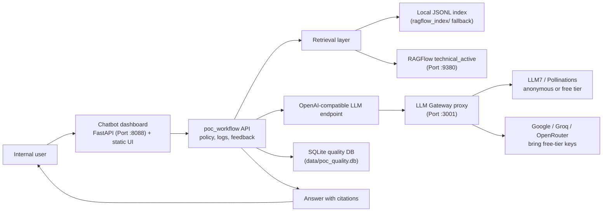
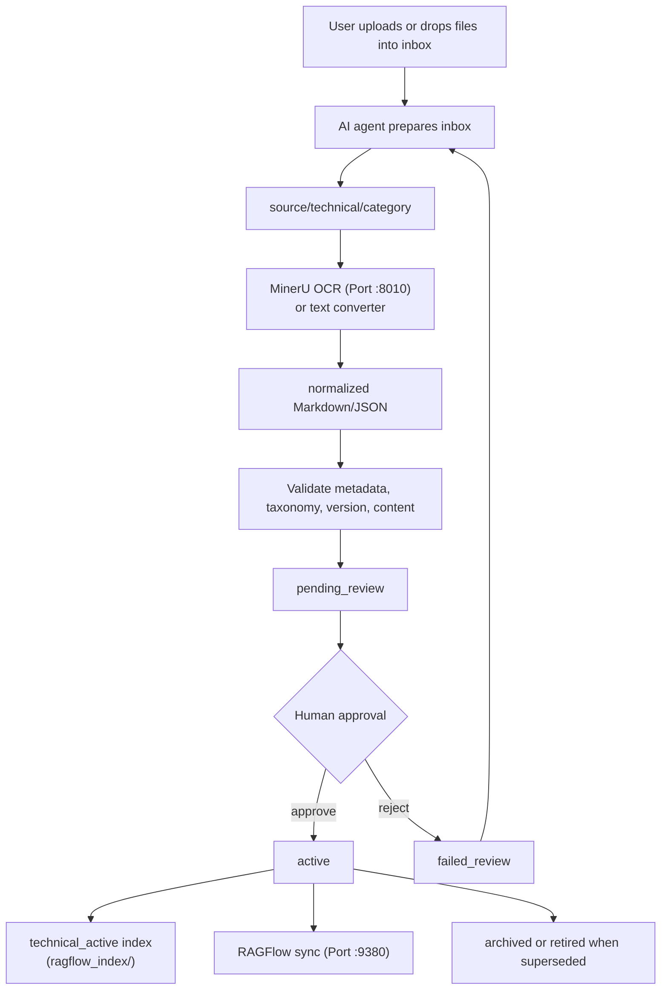

# System Architecture

This product is a governed internal knowledge chatbot for company procedures. The core rule is strict:

```text
Only approved active documents can be used for user answers.
```

## Runtime Architecture



## Document Lifecycle



## Source Of Truth

The durable source of truth is:

- `manifest/records.json`
- `normalized/`
- `source/`
- `eval/regression_cases.json`
- `data/poc_quality.db`

RAGFlow and the local JSONL index are rebuildable caches. Do not edit an index directly without updating the manifest.

## Main Components

- `poc_workflow.pipeline`: workspace init, conversion, validation, lifecycle, rebuild.
- `poc_workflow.intake`: inbox upload/drop workflow and draft metadata generation.
- `poc_workflow.ragflow_http`: RAGFlow dataset/chat bootstrap, sync, search/chat.
- `poc_workflow.chatbot`: retrieval policy, optional LLM answering, feedback gap creation.
- `poc_workflow.llm`: OpenAI-compatible chat completions client.
- `poc_workflow.webapp`: dashboard API and static UI.
- `poc_workflow.evaluation`: regression test harness and KPI reporting.

## Answer Flow

```text
User question
-> provider policy
-> RAGFlow if configured, otherwise local dev index
-> active-only retrieval
-> optional LLM answer generation from retrieved chunks
-> citation payload
-> query log
-> feedback / knowledge gap loop
```

If no valid source exists, the expected answer is:

```text
Không tìm thấy căn cứ trong tài liệu hiện hành.
```

## POC Taxonomy

```text
company
└── department
    └── technical
        ├── procedure
        ├── vendor_document
        ├── form_checklist
        └── faq_troubleshooting
```

## Production Intent

- RAGFlow is the production RAG engine candidate.
- MinerU is the document normalization engine.
- FreeLLMAPI is an optional OpenAI-compatible LLM proxy for free-tier testing.
- The owned app remains the governance, dashboard, quality loop, and integration layer.
