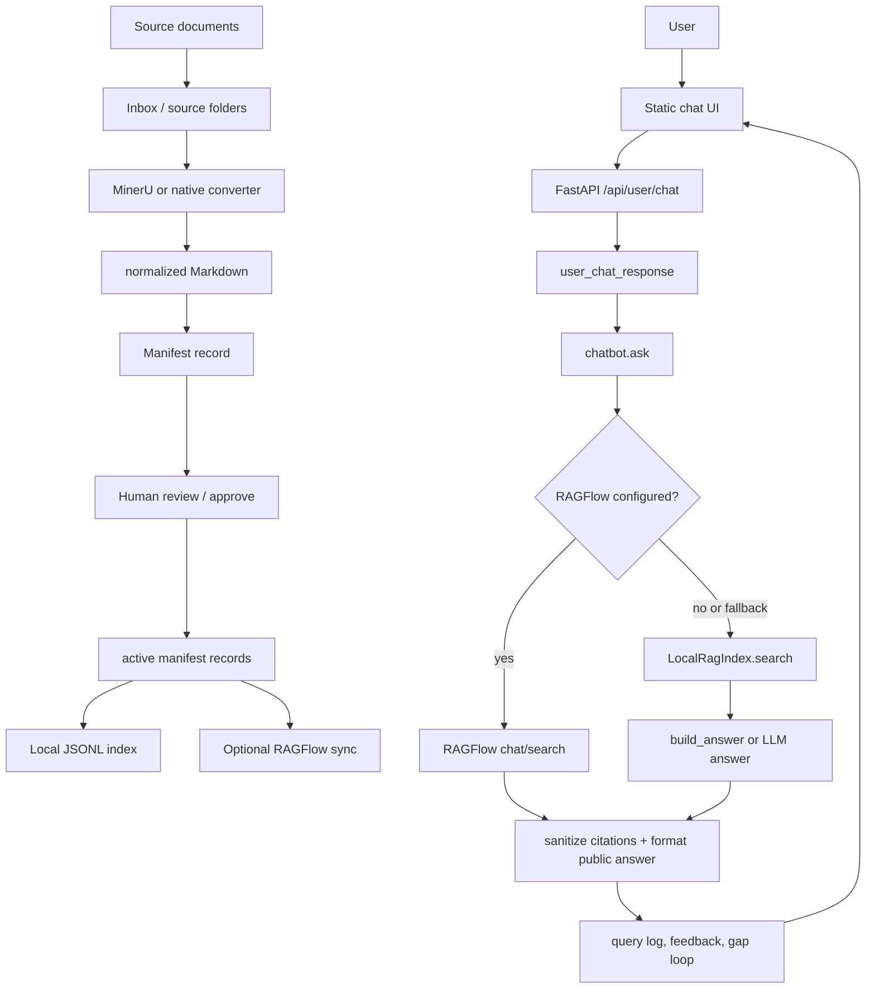

# Chatbot Workflow Review

Generated: 2026-05-25

This document reconstructs the current workflow of the governed internal technical-procedure chatbot and highlights why answers can look poor even when the source document is found correctly.

## Prompt To Send To ChatGPT

Please review the workflow below as a senior RAG/chatbot engineer. The main symptom is: the chatbot often retrieves the correct procedure document, but the final answer is noisy, incomplete, or misses expected business keywords. Identify the most likely root causes, rank them by impact, and suggest a pragmatic fix plan.

Focus on:

1. Whether the architecture correctly separates ingestion, active-document governance, retrieval, answer generation, and QA.
2. Why source accuracy can be high while answer quality is low.
3. Whether local deterministic fallback can produce acceptable answers from these OCR/table-heavy Markdown files.
4. Whether RAGFlow or an LLM should be used differently.
5. What acceptance gates should block release.
6. Which files/functions should be changed first.

## Executive Summary

The program is a governed RAG workflow for internal technical documents. It enforces this core rule:

```text
Only approved active documents can be used for user answers.
```

The current runtime has two answer paths:

- Production-intended path: RAGFlow dataset/chat assistant, if RAGFlow env vars are configured.
- Local fallback path: JSONL index plus deterministic answer builder, used by default when RAGFlow is not configured.

Current observed state:

- Active records: 12.
- Pending review records: 301.
- Active scope: 6 engineering procedure groups, each with a primary PDF and a supporting workbook.
- RAGFlow readiness: not configured.
- Runtime LLM config: no `.runtime/llm-config.json` found.
- Local fallback: enabled.
- Quality gate: accepted in local mode.
- Broader QA test: failing, 48/92 passed.
- QA failure shape: 0 source failures, 44 keyword failures.

Main interpretation: retrieval usually finds the right document, but the answer generator is selecting noisy chunks and compressing OCR/table artifacts into the final response. The current local quality gate is too shallow to catch this because it checks citation/source behavior more strongly than semantic answer completeness.

## High-Level Architecture



## Key Files

Runtime API:

- `poc_workflow/webapp.py`
  - `/api/user/chat`: public/user chat endpoint.
  - `/api/chat`: operator/dashboard chat endpoint.
  - `/api/llm/*`: runtime LLM config and health.
  - `/api/sync-ragflow`, `/api/bootstrap-ragflow`: RAGFlow integration.

User-facing chat orchestration:

- `poc_workflow/user_chat.py`
  - `user_chat_response`: session, clarification, context, ask, public formatting, trace.
  - `needs_clarification`: blocks ambiguous "quy trình này" style questions.
  - `sanitize_public_citations`: only exposes latest active citations.
  - `format_user_answer`: wraps answers into "Tóm tắt / Các bước / Nguồn".

Core answer pipeline:

- `poc_workflow/chatbot.py`
  - `ask`: provider policy, RAGFlow path, local path, logging.
  - `infer_category`: routes query to procedure/vendor/form/FAQ category.
  - `build_catalog_answer`: special case for listing/counting active engineering procedures.
  - `build_answer`: deterministic fallback answer from retrieved chunks.
  - `relevant_answer_points`, `procedure_table_points`: extract answer points.

Local retrieval:

- `poc_workflow/rag_index.py`
  - `LocalRagIndex.rebuild`: chunks active normalized Markdown into JSONL.
  - `LocalRagIndex.search`: term overlap plus heuristic scoring.
  - `quality_adjustment`, `query_intent_adjustment`, `procedure_topic_adjustment`, `source_role_adjustment`: ranking heuristics.

LLM generation:

- `poc_workflow/llm.py`
  - `resolve_llm_config`: runtime config, env config, or FreeLLMAPI autodetect.
  - `OpenAICompatibleClient.answer`: sends selected context to OpenAI-compatible API.

RAGFlow integration:

- `poc_workflow/ragflow_http.py`
  - `sync_active_to_ragflow`: uploads active normalized Markdown and metadata.
  - `answer_with_ragflow`: calls RAGFlow chat/search.
  - `extract_reference_citations`: converts RAGFlow references to app citation payloads.

Ingestion and governance:

- `poc_workflow/pipeline.py`
  - `process_sources`: convert, validate, create pending review records.
  - `approve_record`: move record into active and rebuild index.
  - `rebuild_indexes`: rebuild JSONL from manifest.
- `poc_workflow/document_qa.py`
  - `qa_markdown`: checks too-short content, mojibake, replacement chars, many empty table cells.

Evaluation:

- `poc_workflow/evaluation.py`: regression suite used by quality gate.
- `poc_workflow/quality_gate.py`: release gate.
- `poc_workflow/qa_test_eval.py`: broader QA-test CSV oracle.
- `QA-test/tech_chatbot_qa_test_cases.csv`: 92 QA cases.

## Workflow 1: Document Ingestion

1. User uploads files or drops files into `inbox/`.
2. Operator/agent prepares inbox metadata.
3. Files move into `source/technical/<category>/`.
4. Converter runs:
   - PDF/image: MinerU.
   - DOCX/XLSX/TXT/MD: native conversion or text fallback.
5. Output is written to `normalized/technical/<category>/<doc_id>_v<version>.md`.
6. `document_qa.qa_markdown` writes QA report under `.Workplace/artifacts/.../qa_report.json`.
7. `pipeline.process_sources` creates manifest records in `pending_review`.
8. Human/operator approves selected records.
9. `approve_record` marks approved record `active`, archives old active versions for same family, and rebuilds local JSONL indexes.
10. Optional production path syncs active records to RAGFlow.

Important implementation detail: the local index is not source of truth. It is rebuilt from manifest plus normalized Markdown.

## Workflow 2: Active Scope

The current project intentionally narrowed live answers to one active engineering scope:

```text
engineering_procedures_v1
```

Current active set has 12 records:

| Display code | Active doc IDs | Roles |
| --- | --- | --- |
| PD-TECH-A-01 | KT-QT-142, KT-QT-426 | supporting_workbook, primary_pdf |
| PD-TECH-A-02 | KT-QT-144, KT-QT-401 | supporting_workbook, primary_pdf |
| PD-TECH-A-03 | KT-QT-146, KT-QT-431 | supporting_workbook, primary_pdf |
| PD-TECH-A-057 | KT-QT-150, KT-QT-360 | supporting_workbook, primary_pdf |
| PD-TECH-A-125 | KT-QT-148, KT-QT-376 | supporting_workbook, primary_pdf |
| PD-TECH-C-075 | KT-QT-152, KT-QT-356 | supporting_workbook, primary_pdf |

Everything outside this active scope remains `pending_review` and should not answer user questions.

## Workflow 3: User Chat Request

User UI request:

```text
poc_workflow/static/user/user-chat.js
-> POST /api/user/chat
```

Payload shape:

```json
{
  "query": "...",
  "template_id": "...",
  "answer_style": "brief|steps|checklist|workflow",
  "session_id": "...",
  "device_id": "...",
  "use_llm": true
}
```

FastAPI endpoint:

```text
poc_workflow/webapp.py:/api/user/chat
-> user_chat_response(...)
```

`user_chat_response` steps:

1. Load policy pack and curated templates.
2. Normalize answer style.
3. Create/touch user session.
4. Load recent session turns.
5. If query is ambiguous and has no usable context, return clarification.
6. If it is a follow-up, build a contextual query using recent cited document IDs.
7. Call `chatbot.ask(root, effective_query, provider="auto", use_llm=payload.use_llm)`.
8. Annotate query log with session/template/policy.
9. Sanitize citations so only latest active documents are exposed.
10. Format answer for public UI.
11. Store user chat turn.
12. Build trace steps.
13. Return answer, citations, trace, query log ID, gap ID, policy summary, and session info.

## Workflow 4: Provider Selection In `ask`

`chatbot.ask` does provider handling in this order:

1. Reject provider if not allowed by `KB_ALLOWED_PROVIDERS` or local fallback policy.
2. If provider is `auto` or `ragflow`, read `RAGFlowConfig.from_env()`.
3. If RAGFlow is configured and has chat/search ID:
   - call `answer_with_ragflow`.
   - log answer and citations.
   - create gap if RAGFlow answer has no citation.
4. If RAGFlow fails:
   - provider `ragflow`: return no-source.
   - provider `auto` with local fallback enabled: continue to local index.
5. If RAGFlow is not configured and local fallback is enabled:
   - use local index.
6. If local fallback is disabled:
   - return no-source and create gap.

Current observed environment:

- RAGFlow is not configured.
- Local fallback is enabled.
- No runtime LLM config file exists.

Therefore user chat currently behaves as:

```text
/api/user/chat use_llm=true
-> ask(provider=auto)
-> no RAGFlow config
-> local JSONL retrieval
-> resolve_llm_config returns None
-> deterministic build_answer fallback
```

## Workflow 5: Local Retrieval

Local index path:

```text
ragflow_index/technical_active.jsonl
```

Rebuild logic:

1. Load latest active manifest records.
2. Read normalized Markdown.
3. Split Markdown into chunks, max about 1200 chars.
4. Clean chunk text.
5. Drop empty/low-value chunks.
6. Store chunk metadata:
   - doc_id
   - version
   - title
   - category
   - display_code
   - source_role
   - active_scope_id
   - line_start / line_end

Search logic:

1. Normalize query and tokenize meaningful terms.
2. Filter by department `technical`.
3. Filter by status `active`.
4. Filter by inferred category unless fallback broadening is allowed.
5. Score:
   - text term overlap
   - title term overlap
   - doc_id/display_code match
   - phrase score
   - procedure topic adjustment
   - query intent adjustment
   - source role adjustment
   - quality adjustment
6. Return top hits.
7. `confident_hits` rejects low-confidence results and deduplicates by `(doc_id, version)`.
8. `focus_hits_for_query` narrows to same display code unless the query asks across documents.

Current active local index chunk count:

| Display code | Chunks | Doc IDs |
| --- | ---: | --- |
| PD-TECH-A-01 | 111 | KT-QT-142, KT-QT-426 |
| PD-TECH-A-02 | 64 | KT-QT-144, KT-QT-401 |
| PD-TECH-A-03 | 111 | KT-QT-146, KT-QT-431 |
| PD-TECH-A-057 | 63 | KT-QT-150, KT-QT-360 |
| PD-TECH-A-125 | 50 | KT-QT-148, KT-QT-376 |
| PD-TECH-C-075 | 32 | KT-QT-152, KT-QT-356 |

## Workflow 6: Answer Generation

There are three answer modes:

### 1. RAGFlow answer

Used only when RAGFlow env vars are configured:

```text
RAGFLOW_BASE_URL
RAGFLOW_API_KEY
RAGFLOW_CHAT_ID or RAGFLOW_SEARCH_ID
```

RAGFlow returns answer and references. App extracts citations and logs the answer.

### 2. LLM answer over local hits

Used when local retrieval finds hits and `use_llm=true` and LLM config resolves.

LLM config can come from:

1. `.runtime/llm-config.json` and `.runtime/llm-secrets.json`.
2. `POC_LLM_MODEL` plus `POC_LLM_API_KEY` or `OPENAI_API_KEY`.
3. FreeLLMAPI autodetect on `http://127.0.0.1:3001`.

The LLM system prompt forces:

- answer only from context,
- no unsupported speculation,
- no raw HTML/table/OCR artifacts,
- include source by doc_id and version,
- use the headings `Tóm tắt`, `Các bước / Nội dung chính`, `Nguồn`.

If the LLM returns raw markup, the app retries once with a clean-answer instruction. If still dirty or if the LLM errors, it falls back to deterministic answer builder.

### 3. Deterministic local fallback

Used when:

- `use_llm=false`, or
- `use_llm=true` but no LLM config exists, or
- the LLM call fails.

This path:

1. Takes retrieved hits.
2. Cleans retrieval text.
3. Tries table/procedure point extraction.
4. Ranks candidate lines against query terms.
5. Formats up to 6 points.
6. Adds source labels.

This path is fast and deterministic, but it is fragile when normalized Markdown is OCR-heavy, table-heavy, or line structure is poor.

## Workflow 7: Evaluation And Quality Gates

There are two relevant QA layers:

### Local quality gate

Command:

```powershell
python -m poc_workflow quality-gate
```

Latest result:

```text
Status: accepted
Mode: local
Provider: local
Cases: 13
Blocker failures: 0
```

This gate checks compile/static routes, selected regression cases, sandboxed workflow, deterministic jailbreak/security checks, data audit, readiness, and performance smoke.

Issue: the active quality-gate cases are broad and can pass even when detailed answer content is weak.

### Broader QA test

Command:

```powershell
python -m poc_workflow qa-test --provider local
```

Latest result:

```text
Cases: 48/92
Source failures: 0
Keyword failures: 44
Pass rate: 52.17%
```

Interpretation:

- The retriever generally cites the correct procedure.
- The final answer frequently omits expected details or includes too much noisy text.
- The failure is mainly answer extraction/generation quality, not source selection.

## Concrete Symptom Example

Command:

```powershell
python -m poc_workflow ask "Quy trình lắp đặt gồm những bước nào?" --provider local
```

Observed behavior:

- Provider: local.
- LLM used: false.
- Answer source: `fallback_clean_excerpt`.
- Citation: `PD-TECH-A-01 / KT-QT-426 v1.0`.
- The answer cites the right document but includes OCR/table noise such as:
  - glossary/definition fragments,
  - badly decoded OCR words,
  - table row fragments,
  - mixed form/checklist content,
  - incomplete procedure steps.

Example answer excerpt:

```text
Tóm tắt:
4.3.YCLD:Yeu càu láp dǎt ... 4.10.DVKT: DichVu Ky Thuat

Các bước / Nội dung chính:
1. 4.3.YCLD:Yeu càu láp dǎt ...
2. Thurc hièn các còng vièe chuyen mòn ...
3. 17 | ↓Nop va lru hò so | R | R,A ...
...
Nguồn:
PD-TECH-A-01 / KT-QT-426 v1.0
```

This is structurally valid but not a good business answer.

## Data Quality Observations

Example normalized primary PDF:

```text
normalized/technical/procedure/KT-QT-426_v1.0.md
```

Observed traits:

- Contains raw HTML tables.
- Large parts of procedure tables are compressed into very long lines.
- OCR quality is poor in many Vietnamese words:
  - `láp dǎt` instead of `lắp đặt`
  - `Thurc hièn` instead of `Thực hiện`
  - `hò so` instead of `hồ sơ`
  - `dièu kièn` instead of `điều kiện`
- It contains business content, but the structure is hard for a simple line-based answer builder.

QA report for `KT-QT-426`:

```json
{
  "status": "pass",
  "issues": [],
  "metrics": {
    "characters": 41235,
    "lines": 58,
    "mojibake_score": 0,
    "replacement_characters": 0,
    "empty_table_cells": 0
  }
}
```

Important gap: this QA says pass because it checks encoding and basic file health, not semantic OCR quality or table structure. A file can pass Markdown QA while still being poor retrieval/answer material.

Supporting workbook example:

```text
normalized/technical/procedure/KT-QT-142_v1.0.md
```

Observed traits:

- More structured table content.
- Many empty table cells.
- QA report has `many_empty_table_cells` but still status `pass`.

## Most Likely Failure Points

### 1. Correct source, wrong or noisy chunk

The local retriever finds the correct display code, but the selected chunk often contains a mixture of definitions, table headers, RACI columns, form content, and OCR artifacts. Because the final answer is built from those chunks, the final result is noisy.

Evidence:

- QA test has 0 source failures but 44 keyword failures.
- Example query cites `PD-TECH-A-01` correctly but answer starts with glossary definitions instead of a clean workflow.

### 2. Deterministic fallback is doing too much

`build_answer` tries to synthesize an answer using cleaned text and heuristics. This can work for short clean Markdown, but it is weak for OCR/table-heavy procedure documents.

Evidence:

- Current runtime has no LLM config.
- RAGFlow is not configured.
- User chat passes `use_llm=true`, but `resolve_llm_config` returns no config, so it falls back to `build_answer`.

### 3. Active data has duplicate roles per business procedure

Each business procedure has both PDF and workbook records active. Retrieval can pull from both. This is intentional, but answer generation does not clearly choose which representation is best for each question type.

Possible issue:

- For broad procedure-step questions, `source_role_adjustment` boosts `primary_pdf` and penalizes `supporting_workbook`.
- If the PDF OCR is poor and the workbook table is cleaner, this preference can hurt answer quality.

### 4. Markdown QA is not aligned with answer quality

The QA report catches mojibake and replacement characters, but not:

- OCR accuracy,
- Vietnamese diacritic degradation,
- table row reconstruction quality,
- long one-line table compression,
- whether procedure steps can be extracted.

### 5. Quality gate does not use the full QA oracle as blocker

The local quality gate passes 13 selected cases. The 92-case QA suite fails with 44 keyword failures. This means the release gate can accept a build that users experience as poor.

## Current Risk Assessment

| Risk | Severity | Why it matters |
| --- | --- | --- |
| Local answer quality poor despite correct citations | High | Users lose trust because answers look wrong/noisy. |
| RAGFlow not configured | Medium/High | Production-intended retrieval/generation path is not actually being exercised. |
| LLM not configured | Medium | User UI requests LLM but runtime silently falls back to deterministic extraction. |
| OCR/table normalization weak | High | Bad source chunks poison both local fallback and LLM context. |
| QA gate too permissive | High | The app can be marked accepted while detailed QA is failing. |
| Active PDF/workbook role policy unclear | Medium | System may prefer noisy PDF over cleaner workbook for some queries. |

## Review Questions For ChatGPT

1. Is the current architecture sound for a governed internal RAG chatbot, or should ingestion, retrieval, and answer generation be separated differently?
2. Given 0 source failures but 44 keyword failures, should the first fix target retrieval scoring, chunk construction, answer generation, or document normalization?
3. Should broad procedure questions prefer workbook-derived structured rows over PDF OCR chunks?
4. Should `document_qa.py` add semantic OCR/table quality checks before allowing approval?
5. Should `quality_gate.py` include the 92-case QA suite as a blocker, or should QA cases be split into blocker/warning tiers?
6. Should local deterministic fallback be kept for user-facing answers, or restricted to smoke tests only?
7. If an LLM is enabled, what prompt/context strategy would prevent it from summarizing OCR junk?
8. Should RAGFlow be the main runtime for user answers, with local fallback disabled in production?
9. What is the minimal fix plan that improves answer quality without rewriting the whole app?

## Suggested Fix Direction To Evaluate

Proposed priority order:

1. Block release on `qa-test` pass rate or at least no blocker keyword failures.
2. Improve normalized Markdown quality for the 12 active records, especially PDF table extraction.
3. Add a structured procedure-step extractor that parses the "Nội dung công việc" table into rows with step number, label, owner, detail, and form.
4. Prefer structured workbook rows for detailed procedure questions when available.
5. Keep PDF as official citation source, but use workbook/structured row as answer support if it is cleaner.
6. Add chunk quality metadata so retrieval can down-rank glossary/history/header/form chunks unless the query asks for those sections.
7. Configure either RAGFlow or an OpenAI-compatible LLM for real user chat, then evaluate with the 92-case suite.
8. Make fallback behavior visible in diagnostics/operator UI: `llm_not_configured`, `ragflow_not_configured`, `fallback_clean_excerpt`.

## Minimal Code Areas To Inspect First

1. `poc_workflow/rag_index.py`
   - `chunk_markdown_with_metadata`
   - `quality_adjustment`
   - `query_intent_adjustment`
   - `source_role_adjustment`

2. `poc_workflow/chatbot.py`
   - `ask`
   - `build_answer`
   - `relevant_answer_points`
   - `procedure_table_points`
   - `answer_candidate_score`

3. `poc_workflow/document_qa.py`
   - `qa_markdown`
   - add OCR/table quality checks.

4. `poc_workflow/qa_test_eval.py`
   - decide how to promote QA failures into release blockers.

5. `poc_workflow/llm.py`
   - inspect whether prompt is enough if context chunks remain noisy.

## Expected Good Answer Shape

For:

```text
Quy trình lắp đặt gồm những bước nào?
```

A useful answer should be close to:

```text
Tóm tắt:
Quy trình lắp đặt áp dụng khi phát sinh yêu cầu lắp đặt máy, từ tiếp nhận yêu cầu, khảo sát điều kiện, chuẩn bị nguồn lực, thực hiện lắp đặt, chạy thử, bàn giao, cập nhật phần mềm và lưu hồ sơ.

Các bước / Nội dung chính:
1. Kinh doanh gửi yêu cầu lắp đặt đầy đủ thông tin.
2. Kỹ thuật khảo sát điều kiện lắp đặt.
3. Nếu chưa đủ điều kiện, tư vấn khách hàng chuẩn bị thêm cơ sở vật chất.
4. Kỹ thuật hoặc Ứng dụng sản phẩm xác nhận điều kiện và chuẩn bị nhân sự, công cụ, phụ kiện/hóa chất.
5. Tạo phiếu giao việc và tiếp nhận hồ sơ lắp đặt.
6. Tiếp nhận máy, kiểm tra tình trạng bất thường và thông báo DVKH/Kinh doanh nếu cần.
7. Thực hiện lắp đặt, chạy thử và xử lý nếu máy không hoạt động bình thường.
8. Bàn giao, cập nhật thông tin trên phần mềm, ký BBDVKT và nộp hồ sơ trong thời hạn quy định.

Nguồn:
PD-TECH-A-01 / KT-QT-426 v1.0
```

The current local fallback answer does not reliably reach this quality.
