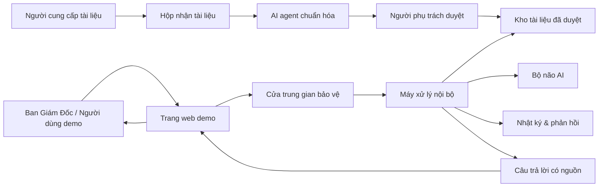
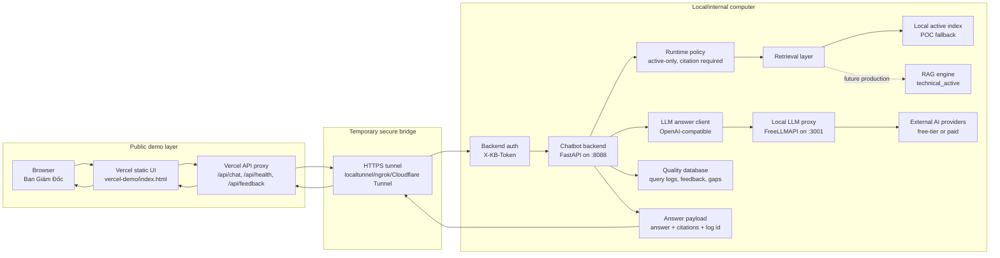
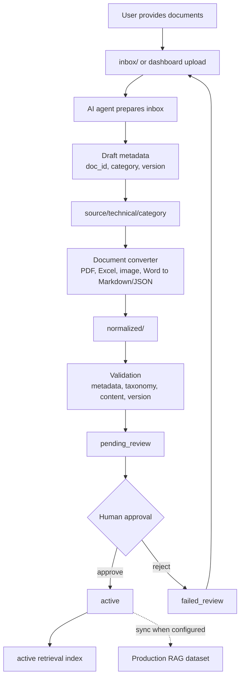
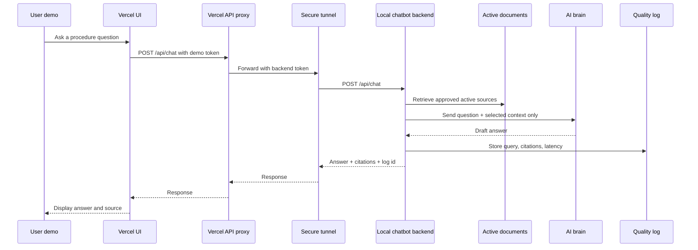
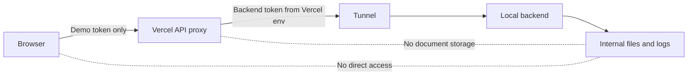

# Demo End-To-End Architecture

This document describes the current demo architecture: Vercel is only the public interface, while data, retrieval, AI orchestration, logs, and document processing stay on the local/internal machine.

## Executive View



Meaning:

- Public web only shows the demo interface.
- Internal machine owns the real processing.
- Only approved active documents are used for answers.
- Feedback creates improvement signals for the knowledge base.

## Technical Runtime View



## Document Processing View



## Query Flow



## Security Boundaries



Key controls:

- Browser never receives the local backend token.
- Vercel demo does not store company documents.
- Local backend enforces operator token when auth is enabled.
- Only active approved documents are retrieved.
- Full document repository is not sent to the AI provider.

## Current Temporary Demo

```text
Vercel UI: https://vercel-demo-nu-gold.vercel.app
Backend tunnel: https://petite-islands-love.loca.lt
Local backend: http://127.0.0.1:8088
Local LLM proxy: http://127.0.0.1:3001
```

This is a temporary demo path. For production, replace the temporary tunnel with a controlled internal deployment or approved secure gateway.
