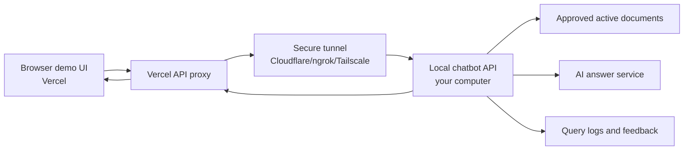

# Vercel Demo Flow

Yes, the executive-facing interface can run on Vercel while the actual document system remains on the local computer.

The implemented demo frontend lives in:

```text
vercel-demo/
```

## Current Temporary Demo Link

Last deployed on May 23, 2026:

```text
https://vercel-demo-nu-gold.vercel.app
```

Demo access token:

```text
demo-kt-2026
```

Current temporary backend tunnel:

```text
https://petite-islands-love.loca.lt
```

Important: this link works only while the local computer is running:

- chatbot backend on `http://127.0.0.1:8088`;
- FreeLLMAPI on `http://127.0.0.1:3001`;
- localtunnel process for port `8088`.

This temporary link is suitable for a quick internal check, not a stable production URL.

It is intentionally lightweight:

- It does not contain document parsing, retrieval, or AI provider logic.
- It calls Vercel API routes.
- Vercel API routes proxy requests to the local backend through a secure public tunnel.
- The browser only sees a demo token, not the internal backend token.

## Executive View

```text
Ban Giam Doc
-> Vercel demo web page
-> Ask a procedure question
-> See short answer + source document + feedback buttons
```

## Technical Flow



## Why This Is Useful

- The demo URL is easy to share.
- The real system and documents stay on the local/internal machine.
- Board members see the workflow, not the internal technology stack.
- The backend token is kept in Vercel environment variables.
- The local machine can be shut down after the demo.

## Required Local Backend Setup

Run the local chatbot with auth enabled:

```powershell
cd D:\MyProject\demo-chatbot-engineerworkflow
$env:KB_REQUIRE_AUTH="true"
$env:KB_AUTH_TOKEN="<long-random-token>"
.\scripts\start-app.ps1
```

Local backend:

```text
http://127.0.0.1:8088
```

## Expose The Local Backend

Vercel cannot call `127.0.0.1` on your computer. Use one of these:

```text
Cloudflare Tunnel
ngrok
Tailscale Funnel
internal VPN + reverse proxy
```

Example target:

```text
https://your-demo-tunnel.example.com -> http://127.0.0.1:8088
```

## Vercel Environment Variables

Set these in the Vercel project:

```text
KB_BACKEND_BASE_URL=https://your-demo-tunnel.example.com
KB_BACKEND_TOKEN=<same value as KB_AUTH_TOKEN>
DEMO_ACCESS_TOKEN=<short demo password for viewers>
```

Meaning:

- `KB_BACKEND_BASE_URL`: public HTTPS tunnel URL to the local chatbot.
- `KB_BACKEND_TOKEN`: private backend token; not exposed to the browser.
- `DEMO_ACCESS_TOKEN`: password viewers type in the demo page.

## Deploy

```powershell
cd D:\MyProject\demo-chatbot-engineerworkflow\vercel-demo
vercel
vercel --prod
```

If using Vercel CLI for the first time, log in first:

```powershell
vercel login
```

## Local Test Before Deploy

The functions are plain Node files. Basic syntax check:

```powershell
node --check api/chat.js
node --check api/feedback.js
node --check api/health.js
node --check lib/proxy.js
```

## Security Notes

- Do not put `KB_BACKEND_TOKEN` in frontend JavaScript.
- Keep `DEMO_ACCESS_TOKEN` enabled for shared demos.
- Prefer a temporary tunnel URL for one-off board demos.
- Use HTTPS tunnel URLs only.
- Do not expose upload/admin endpoints in the Vercel demo unless required.
- Keep the Vercel demo read-mostly: chat, citations, feedback.
- The UI shows user-friendly status messages when the local backend is offline, in maintenance mode, or degraded.

## Cost Model

For a POC/demo:

```text
Vercel static UI/API proxy: usually low or free tier
Tunnel: free or low-cost depending provider
Local machine: existing hardware
AI calls: depends on configured provider usage
Document processing: done locally/agent-assisted
```

For production, move from tunnel-based demo to a controlled internal deployment or a properly hosted backend.
