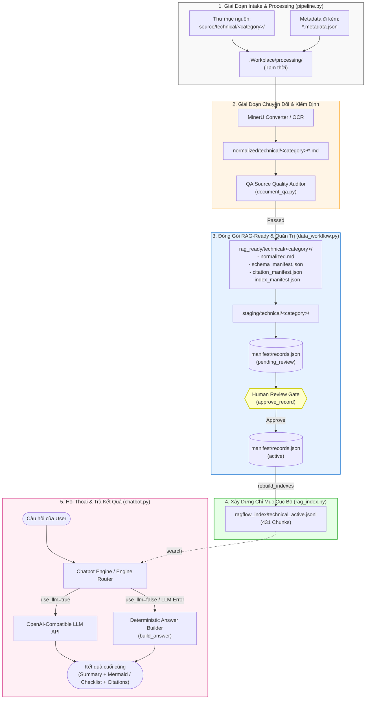
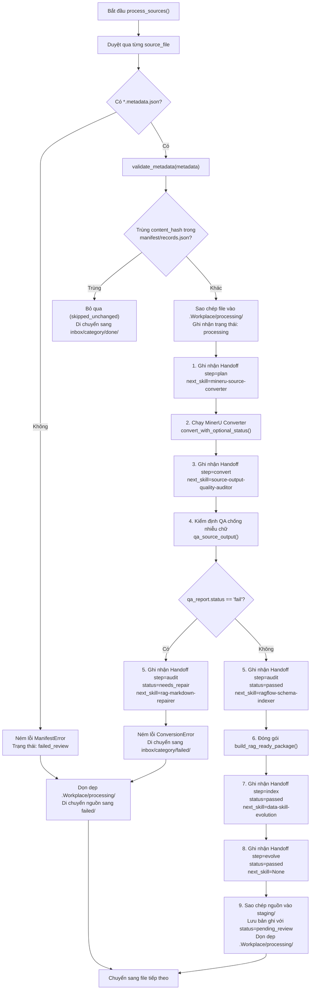
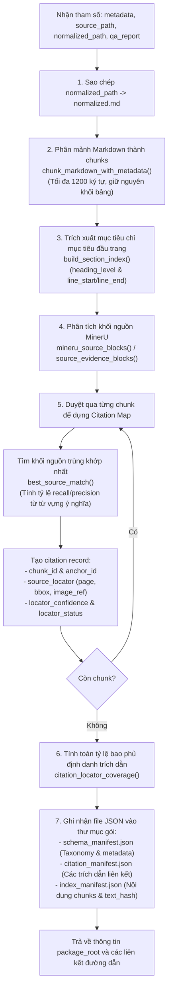
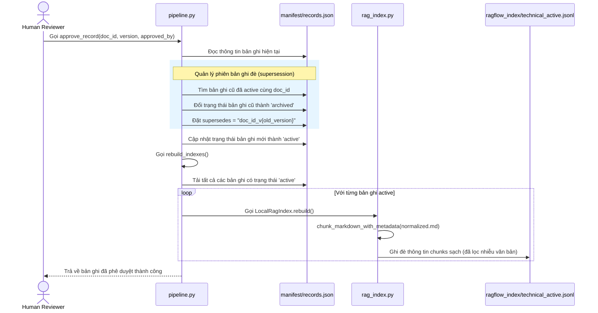
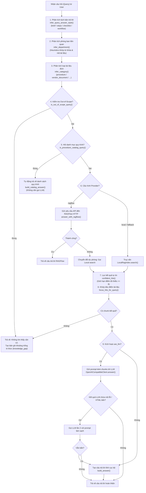
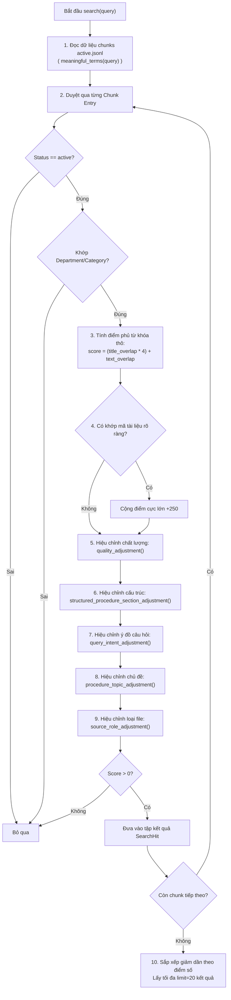
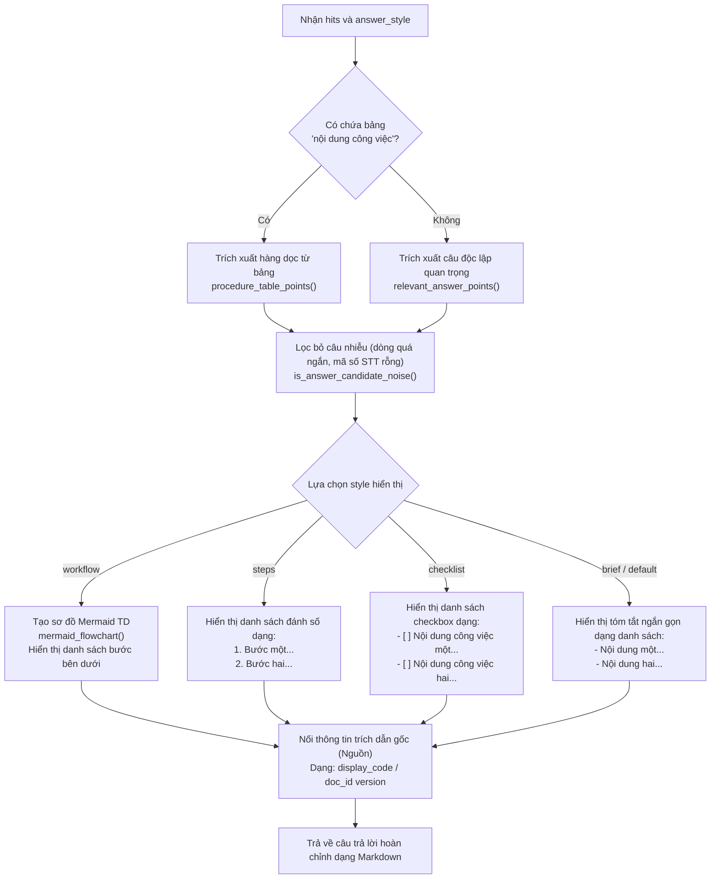
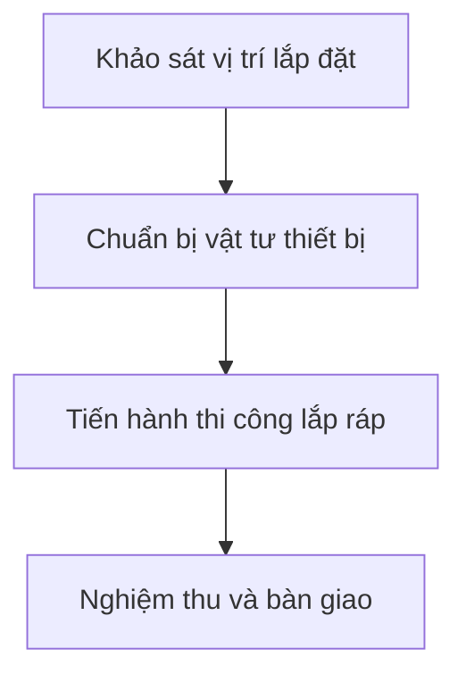

# 🗺️ System Architecture Workflows — End-to-End RAG Q&A System

Tài liệu này trực quan hóa toàn bộ hoạt động của hệ thống từ lúc tiếp nhận tài liệu thô (raw sources) cho đến khi sinh kết quả trả về cho người dùng (user response). Các sơ đồ được chia thành 3 cấp độ:
- **Macro-Level System Pipeline**: Dòng chảy tổng quan của hệ thống.
- **Ingestion & Data Preparation Micro-Workflows**: Chi tiết quá trình xử lý, kiểm định QA và đóng gói dữ liệu RAG-ready.
- **Query, Retrieval & Generation Micro-Workflows**: Chi tiết quá trình định tuyến câu hỏi, chấm điểm tìm kiếm cục bộ và tạo câu trả lời (Mermaid flowcharts, checklists).

---

## 1. Macro-Level System Pipeline (Tổng Quan End-to-End)

Sơ đồ dưới đây thể hiện dòng dữ liệu từ tài liệu thô ban đầu (PDF, DOCX, XLSX) đi qua các bước chuyển đổi, kiểm định QA, phê duyệt của con người, xây dựng chỉ mục tìm kiếm và phục vụ API hội thoại.



---

## 2. Ingestion & Data Preparation Micro-Workflows

Quy trình chuẩn bị dữ liệu chịu trách nhiệm kiểm tra cấu trúc, chuyển đổi tài liệu thô thành Markdown chuẩn hóa, kiểm định tính toàn vẹn và ánh xạ chính xác tọa độ trích xuất nguồn từ MinerU (bounding boxes) làm căn cứ trích dẫn.

### 2.1 Chi tiết Hàm `process_sources()` & Handoff Transitions

Mỗi tài liệu đi qua một chuỗi các bước được quản lý bởi Handoff Contract (`workflow/handoffs.jsonl`). Sơ đồ này mô tả chi tiết các check gates và xử lý ngoại lệ:



### 2.2 Micro-Workflow Đóng Gói RAG-Ready (`build_rag_ready_package`)

Khi tài liệu vượt qua vòng kiểm duyệt chất lượng QA, hệ thống thực hiện phân mảnh (chunking) và ánh xạ trích dẫn thông tin địa chỉ từ MinerU JSON hoặc PDF/XLSX:



### 2.3 Quy Trình Duyệt & Tái Tạo Chỉ Mục Tìm Kiếm (`approve_record`)



---

## 3. Query, Retrieval & Generation Micro-Workflows

Quy trình này điều hướng câu hỏi người dùng, tìm kiếm nguồn tương đồng trong cơ sở tri thức cục bộ và định dạng câu trả lời theo các kịch bản trình bày trực quan.

### 3.1 Quy Trình Định Tuyến & Sinh Câu Trả Lời (`ask()`)



### 3.2 Micro-Workflow Tìm Kiếm & Chấm Điểm Thô (`LocalRagIndex.search()`)

Bản chất của tìm kiếm local là quét toàn bộ tập tin `ragflow_index/*.jsonl` để chấm điểm dựa trên độ tương đồng từ vựng và 7 yếu tố hiệu chỉnh ngữ cảnh (adjustments):



### 3.3 Công Thức Tính Điểm Chi Tiết (Heuristic Adjustments)

Để bảo đảm câu trả lời tập trung đúng phần nội dung công việc hơn là các phần thông tin hành chính, điểm số thô được hiệu chỉnh qua các logic sau:

```
[Điểm Cuối Cùng] = Điểm Thô + [Hiệu Chỉnh Chất Lượng] + [Hiệu Chỉnh Cấu Trúc] + [Hiệu Chỉnh Ý Đồ] + [Hiệu Chỉnh Chủ Đề] + [Hiệu Chỉnh Loại File] + [Mã Tài Liệu Boost]
```

| Tên Bộ Hiệu Chỉnh | Điều Kiện & Logic Chấm Điểm | Giá Trị Điểm |
| :--- | :--- | :--- |
| **Mã Tài Liệu Boost** | Khớp chính xác mã tài liệu (VD: `PD-TECH-A-01` hoặc `KT-QT-003`) | **+250** |
| **Hiệu Chỉnh Chất Lượng** | Gặp từ khóa nhiễu OCR (`low_hits`) hoặc chứa bảng lịch sử sửa đổi | **-30** |
| | Chunk thuộc trang danh mục tổng hợp tài liệu viết tắt | **-30** |
| | Câu hỏi chứa quy trình và chunk chứa bảng "Nội dung công việc" | **+18** |
| | Chunk chứa bảng biểu STT dòng số `1 \|` (điểm bắt đầu bước quy trình) | **+35** |
| **Hiệu Chỉnh Cấu Trúc** | Trích xuất các bước thủ tục: Chunks chứa tiêu đề "Quy trình thực hiện" kèm số thứ tự | **+95** |
| | Trích xuất các bước thủ tục: Chunk chỉ chứa "Tóm tắt cấu trúc phục vụ RAG" | **-90** |
| | Hỏi về hồ sơ/biểu mẫu: Chunks chứa tiêu đề "Hồ sơ / Biểu mẫu" hoặc code `BM-` | **+85** |
| | Hỏi về vai trò/trách nhiệm: Chunks chứa tiêu đề "Trách nhiệm" hoặc bảng RACI | **+85** |
| **Hiệu Chỉnh Ý Đồ** | Khớp mục đích (`+70`), phạm vi áp dụng (`+70`), trách nhiệm thực hiện (`+65`), điều kiện lắp đặt (`+65`), biên bản ký nhận dịch vụ (`+70`), yêu cầu dự trữ vật tư (`+65`), hiệu chuẩn ccdc (`+40`), chứng chỉ đào tạo (`+55`). Nếu không khớp các từ khóa chính đi kèm | **+40 đến +70**<br>*(Phạt **-25** nếu sai ý đồ)* |
| **Hiệu Chỉnh Chủ Đề** | Khớp từ khóa chủ đề trong tiêu đề tài liệu (`lắp đặt`, `bảo dưỡng`, `sửa chữa`, `đào tạo`, `hiệu chuẩn`) | **+55**<br>*(Phạt **-55** nếu lệch)* |
| **Hiệu Chỉnh Loại File** | Hỏi về bước thủ tục nghiệp vụ $\rightarrow$ Ưu tiên văn bản chính | **+18** cho PDF |
| | Hỏi về bảng biểu mẫu, cấu trúc mẫu tính toán $\rightarrow$ Ưu tiên file đính kèm | **+14** cho XLSX |
| | Hỏi về bước quy trình thực hiện nhưng trúng chunk XLSX | **-18** cho XLSX |

---

## 4. Quy Trình Chuyển Đổi Định Dạng Trả Về (Response Style Visualizer)

Khi nhận tập các chunks tốt nhất từ `LocalRagIndex`, hàm `build_answer()` hoặc `OpenAICompatibleClient` sẽ chuyển đổi các câu văn thô trong chunk thành kịch bản hiển thị đẹp mắt tương ứng với `answer_style` được yêu cầu:



### Ví dụ định dạng trả về theo từng loại Style:

````carousel
```markdown
### 1. Workflow Style (Biểu đồ + Bước thực hiện)

Tóm tắt:
PD-TECH-A-01: Quy trình lắp đặt thiết bị gồm các bước khảo sát và thi công.

Workflow:


Các bước / Nội dung chính:
1. Khảo sát vị trí lắp đặt
2. Chuẩn bị vật tư thiết bị
3. Tiến hành thi công lắp ráp
4. Nghiệm thu và bàn giao

Nguồn:
PD-TECH-A-01 / KT-QT-001 v1.0
```
<!-- slide -->
```markdown
### 2. Steps Style (Danh sách các bước có thứ tự)

Tóm tắt:
Các bước thực hiện bảo dưỡng định kỳ thiết bị kỹ thuật theo đúng tiêu chuẩn vận hành.

Các bước / Nội dung chính:
1. Tiếp nhận yêu cầu bảo dưỡng từ bộ phận dịch vụ khách hàng.
2. Lập kế hoạch bảo dưỡng định kỳ chi tiết gửi khách hàng phê duyệt.
3. Kỹ thuật viên chuẩn bị công cụ dụng cụ và vật tư thay thế.
4. Thực hiện các thao tác vệ sinh, đo đạc và căn chỉnh thiết bị.
5. Ký nghiệm thu biên bản dịch vụ kỹ thuật và cập nhật lịch sử thiết bị.

Nguồn:
PD-TECH-A-02 / KT-QT-002 v2.0
```
<!-- slide -->
```markdown
### 3. Checklist Style (Danh sách kiểm tra công việc)

Tóm tắt:
Danh sách các biểu mẫu và hồ sơ bắt buộc phải chuẩn bị đầy đủ trước khi bàn giao thiết bị.

Các bước / Nội dung chính:
- [ ] Điền thông tin khách hàng vào biên bản dịch vụ kỹ thuật (BM-012)
- [ ] Chụp ảnh hiện trạng lắp đặt tại phòng lab của khách hàng
- [ ] Ký xác nhận bàn giao thiết bị của đại diện kỹ thuật hãng
- [ ] Điền phiếu bàn giao công cụ dụng cụ kèm danh mục serial number

Nguồn:
PD-TECH-A-01 / KT-QT-001 v1.0
```
````
